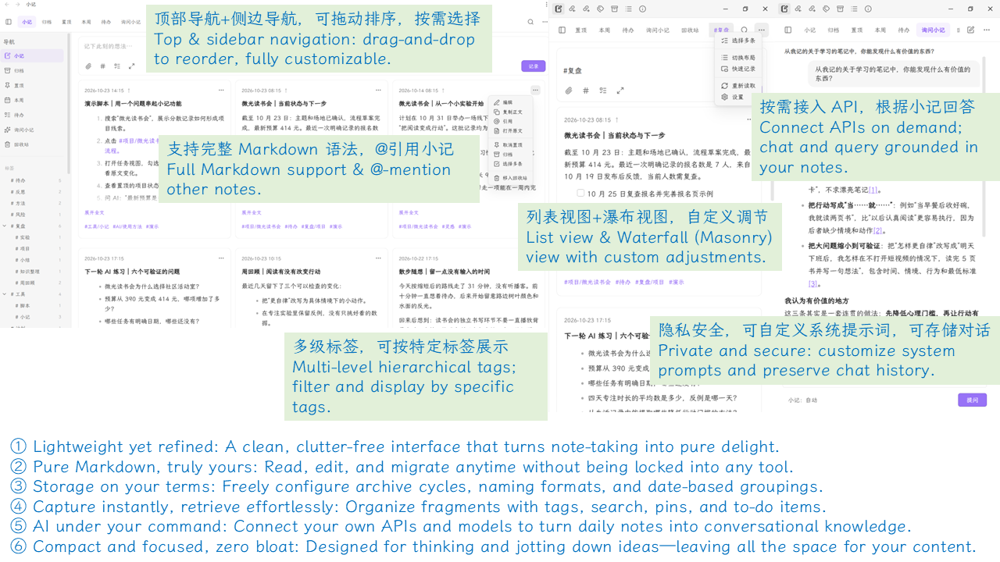
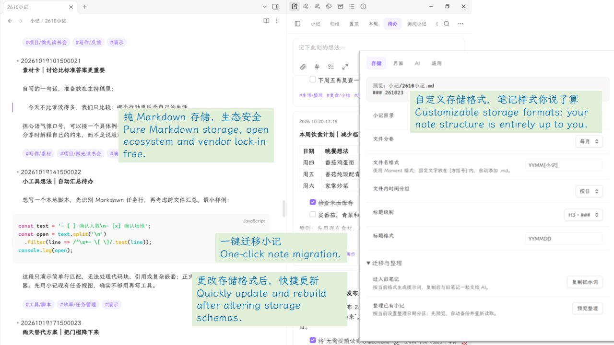

# 小记 · xiaoji

简洁、本地优先的 Obsidian 小记插件，让灵感、日常与待办留在自己的 Markdown 里。

A quiet, local-first memo plugin for Obsidian. Keep ideas, everyday moments and tasks in your own Markdown files.





## 功能 · Features

| 中文 | English |
| --- | --- |
| 原生 Markdown，支持标签、待办、附件、代码、表格与公式 | Native Markdown with tags, tasks, attachments, code, tables and math |
| 列表与瀑布流、置顶、归档、层级标签、搜索与批量整理 | List and waterfall layouts, pins, archives, nested tags, search and batch actions |
| 顶部与侧栏独立配置，拖动排序 | Configure top and sidebar navigation separately; drag to reorder |
| 桌面快速记录小窗，可置顶并转回主页面继续编辑 | Desktop quick capture with always-on-top and transfer to the main composer |
| 自定义存储、日期分组，Markdown 回收站与格式备份 | Flexible storage and date headings, Markdown Trash and formatting backups |
| 可选 AI：检索小记、自定义提示词、保存或临时对话 | Optional AI with memo retrieval, custom prompts, saved or temporary chats |

## 安装与升级 · Installation & updates

需要 **Obsidian 1.8.7+**；独立快速记录小窗仅限桌面端。

Requires **Obsidian 1.8.7+**. The standalone quick-capture window is desktop-only.

1. 从[同一版本的 Release](https://github.com/cimuyang/xiaoji/releases) 下载 `main.js`、`manifest.json`、`styles.css`。
   Download these three files from the [same release](https://github.com/cimuyang/xiaoji/releases).
2. 放入笔记库的 `.obsidian/plugins/xiaoji/`，重新加载 Obsidian，在「第三方插件」中启用。
   Place them in `<vault>/.obsidian/plugins/xiaoji/`, reload Obsidian and enable xiaoji under Community plugins.
3. 升级时只替换上述文件，保留 `data.json`、笔记与附件。
   When updating, replace only these files. Keep `data.json`, notes and attachments.

## 记录与整理 · Capture & organize

- 点击侧栏小记图标或从命令面板打开。**Enter 换行，Shift+Enter 记录**；快捷键可在「通用」中修改。
  Open from the ribbon icon or command palette. **Enter inserts a newline; Shift+Enter saves.** Customize both keys in General.
- 输入 `#` 或点击标签按钮选择标签；双击卡片回到顶部编辑，右键或 `⋯` 管理小记。
  Type `#` or click the tag button for suggestions. Double-click a card to edit at the top; right-click or use `⋯` for actions.
- 点击标签筛选；进入多选后，可点选或拖动框选，按住 Shift 追加选择。
  Filter by tags. In selection mode, click or drag a rectangle; hold Shift to add to the selection.
- 点击 `@ID` 引用定位，Ctrl／⌘ 悬停预览；删除的小记可在插件回收站恢复。
  Click an `@ID` reference to locate its memo; Ctrl/⌘ + hover previews it. Restore deleted memos from the plugin Trash.


## AI 与文件 · AI & files

- AI 默认关闭。启用后配置兼容 Chat Completions 的服务地址、模型和密钥；选择「自动」「仅小记」或「不使用小记」，有来源的回答可展开相关小记。
  AI is off by default. Configure a Chat Completions-compatible endpoint, model and key. Choose Auto, Memos only or No memos; expand related sources when available.
- 可自定义对话目录、提示词，或使用临时会话。问题及按模式选择的小记内容会发送给服务商；临时模式不控制服务商的数据保留。
  Customize the chat folder and prompts, or use temporary sessions. Questions and context selected by the mode go to your provider; temporary mode does not control provider retention.
- 普通记录与搜索无需联网。密钥使用 Obsidian 密钥存储；不支持时仅保留在当前会话，不写入笔记或插件配置。
  Capture and search work offline. Keys use Obsidian secret storage; unsupported hosts keep them in memory only, outside notes and plugin settings.
- 可按月／季／年分卷，自定义文件名与日期标题。整理历史格式会先预览并备份，不自动重命名或重新分卷；迁移提示词只复制，不自动上传旧笔记。
  Choose monthly, quarterly or yearly files and custom names/headings. Reformatting previews and backs up existing notes without renaming or repartitioning them. Migration prompts are copied; old notes are not uploaded automatically.


## 开发 · Development

使用 Node.js 22.13+ 与 npm；验证包含代码检查、类型检查、回归测试和生产构建。

Use Node.js 22.13+ and npm. Verification runs lint, type checks, regression tests and a production build.

```sh
npm ci
npm run verify
```

构建把 `main.js`、`manifest.json`、`styles.css` 一并输出到 `dist/`。

The build outputs `main.js`, `manifest.json` and `styles.css` together into `dist/`.

本地调试用 `reload.sh`：指定 vault 目录后，它会构建、拷贝到插件目录并通过 Obsidian CLI 重载。配置一次 `VAULT_DIR` 即可：

For local development use `reload.sh`: it builds, copies to the plugin folder and reloads via the Obsidian CLI. Set `VAULT_DIR` once:

```sh
echo 'VAULT_DIR=/path/to/vault' > reload.local.sh   # git-ignored
npm run reload              # 生产构建 + 重载 / prod build + reload
npm run reload dev          # dev 构建（内联 sourcemap）+ 重载 / dev build + reload
```

更新记录见 [CHANGELOG.md](CHANGELOG.md)，兼容性说明见 [REVIEW_NOTES.md](REVIEW_NOTES.md)。

See [CHANGELOG.md](CHANGELOG.md) for changes and [REVIEW_NOTES.md](REVIEW_NOTES.md) for compatibility notes.

## 许可 · License

[MIT](LICENSE)
